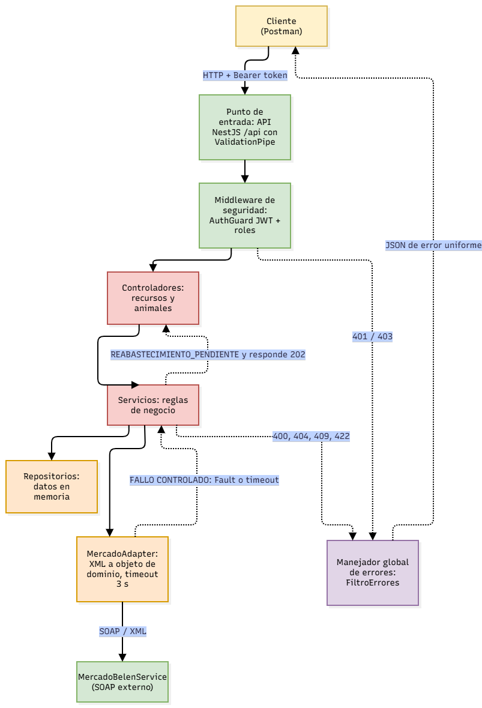

# Pesebre API · Escenario C (Parcial 1)

API en NestJS para gestionar los recursos del pesebre de Belén y alimentar a sus animales. Repone existencias consultando al Mercado de Belén, un servicio SOAP heredado.

## Cómo levantar el proyecto

1. Instalar dependencias: `npm install`
2. Copiar `.env.example` a `.env` y completar `JWT_SECRET` con un texto largo.
3. (Opcional) Levantar el mock del Mercado: `node scripts/mock-mercado.js`
4. Iniciar la API: `npm run start:dev` (queda en `http://localhost:3000/api`)

## Variables de entorno

| Variable      | Descripción                                                                      |
| ------------- | -------------------------------------------------------------------------------- |
| `PORT`        | Puerto de la API (3000)                                                          |
| `JWT_SECRET`  | Secreto para firmar y validar los tokens                                         |
| `MERCADO_URL` | Endpoint SOAP del Mercado de Belén (el mock usa `http://localhost:4000/mercado`) |

## Usuarios y tokens de prueba

Con la API configurada, genera los tokens con `node scripts/generar-tokens.js`:

- **ENCARGADO_PESEBRE**: puede crear, consumir, reabastecer y eliminar recursos.
- **PASTOR**: token válido pero sin permiso, sirve para probar el 403.

Se envían en el header `Authorization: Bearer <token>`. Los GET y los endpoints de animales son públicos.

## Arquitectura

Rutas → controladores → servicios → repositorios. Las reglas de negocio viven en la capa de servicios y los controladores solo reciben y responden. El servicio SOAP se consume desde `MercadoAdapter`, que traduce XML ↔ objeto de dominio, así el resto del sistema no conoce XML. Si el Mercado responde con un Fault o tarda más de 3 segundos, el recurso queda en `REABASTECIMIENTO_PENDIENTE`, la cantidad no cambia y la API responde 202. Un filtro global da el mismo formato JSON a todos los errores.

## Colección de Postman

Está en `postman/` e incluye los casos 200/201, 400, 401, 403, 404, 409, 422 y el SOAP caído (202).

## Si el Polo Norte separara el sistema en microservicios

Separaría tres servicios: Recursos (recursos, cantidades y estados), Animales (animales y su alimentación) y Abastecimiento (integración con el Mercado de Belén). Cada uno tendría su propia base de datos: Recursos guarda cantidad, stockMinimo y estado; Animales guarda especie, ración y última alimentación; Abastecimiento guarda las solicitudes pendientes. Hoy Animales descuenta alimento llamando directo a Recursos; en microservicios lo haría por API o eventos. Si Recursos cae el 24 de diciembre a las 23:00, alimentar animales respondería 503 con el formato estándar y no descontaría nada, mientras consultar animales seguiría funcionando. Si cae el Mercado, ya está resuelto: el recurso queda en `REABASTECIMIENTO_PENDIENTE` y se responde 202. Con una cola de mensajes, los pedidos pendientes se reintentarían solos al volver el servicio.
